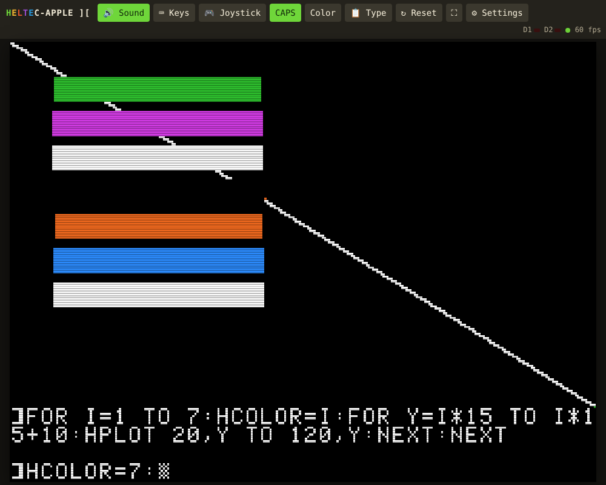

# Heltec-AppleII

An **Apple IIe** (or Apple ][+) running on a **Heltec WiFi LoRa 32 V3** (the Meshtastic board), played in any
**web browser** on your Wi‑Fi, **with sound**. Works on a PC, Mac or iPhone; nothing to install.
A sibling of Heltec-C64 and Heltec-Mac.

- 65C02 CPU (passes Klaus Dormann's 6502 functional test **and** 65C02 extended-opcode test), or an
  NMOS 6502 with its undocumented opcodes when you use a ][+ ROM
- 128K Apple IIe: main + auxiliary memory, every IIe soft switch, language card, 80-column firmware
- Text 40/80 columns, lo-res, double lo-res, hi-res (with colour artifacts) and double hi-res
- Speaker sound, paddles/joystick and the two push buttons (Open Apple / Solid Apple)
- **Disk II** in slot 6 with **two drives**, `.dsk` / `.do` / `.po` images, real nibble-level reading
  (DOS 3.3, ProDOS and custom loaders), and **writing back** to the image (SAVE works)
- Its own Disk II boot ROM, written from scratch, so you only need the main Apple ROM
- Colour, green, amber or white monitor; on-screen IIe keyboard and touch joystick for phones
- OLED shows the address to open (or a mini view of the Apple screen)



> **Why a IIe and not a full IIgs?** A IIgs needs 256 KB+ of RAM plus 64 KB of sound RAM; the Heltec V3 has
> 512 KB in total with no PSRAM, and Wi‑Fi takes a big share. This is the Apple II side of the family:
> the same 8-bit machine a IIgs becomes when it boots a 5.25" disk, so it runs the same 5.25" software.

> Flashing this replaces Meshtastic. To go back, reflash Meshtastic from flasher.meshtastic.org.

## 1. Flash it

**Easiest:** open the **[Heltec-AppleII Flasher](https://hardwaremack-prog.github.io/Heltec-AppleII/flasher/)** in
Chrome or Edge on a computer, plug the board in with USB‑C, click **INSTALL HELTEC-APPLEII**, pick its
port and click Install. Tick *Erase* the first time; leave it unticked when updating so your ROM and
disk images are kept. Press the board's RST button when it's done.

**Or with esptool** (`pip install esptool`):
```
esptool --chip esp32s3 write-flash 0x0 firmware/Heltec-AppleII.bin
```
If the board doesn't show up, hold **PRG**, tap **RST**, release **PRG**, then try again.
Re-flashing an update keeps your ROM and disk images (unless you erase).

## 2. Get it on Wi‑Fi

First boot, the board makes a hotspot **AppleII-Setup**, password **appleiie**. Join it, open
**http://192.168.4.1/settings**, pick your network under *Wi‑Fi*, save. The board reboots onto your
network and the OLED shows its address.

## 3. Add your ROM and a disk

Open **http://\<board-ip\>/settings** (or **http://apple2.local/settings**):

1. **System ROM** → pick your ROM file → **Upload & restart**

   | Machine | File size | Contents |
   |---|---|---|
   | Apple IIe enhanced (best) | 16 KB | `$C000-$FFFF` (342-0304 + 342-0303) |
   | Apple IIe (original) | 16 KB | `$C000-$FFFF` (342-0135 + 342-0134) |
   | Apple IIe, 32 KB dump | 32 KB | the last 16 KB is used |
   | Apple ][+ | 12 KB | `$D000-$FFFF` |

   Apple's ROMs are not included. Until you add one, the Apple shows a reminder screen.
2. **Disk drives** → pick a `.dsk`, `.do` or `.po` file (140 KB) → **Upload**. With *put in drive 1
   and boot* ticked it boots straight away. Use **D1** / **D2** to swap disks, **Boot** to restart with a
   disk, **↓** to download an image (with anything programs saved to it), **×** to delete it.
   About 40 images fit in the 6 MB of storage.

## 4. Play

Open **http://\<board-ip\>/** and tap/click the screen once (browsers only allow sound after a tap).
One viewer at a time; opening it somewhere else takes over.

Toolbar: 🔊 sound · ⌨ on-screen keyboard · 🎮 touch joystick · CAPS lock · Color/Green/Amber/White
monitor · 📋 type or paste text · ↻ Ctrl-Reset · ⛶ full screen · ⚙ settings. The two red lights
are the drive lights.

| PC key | Apple key |
|---|---|
| Arrows | ← → ↑ ↓ |
| Backspace | ← (backspace, as on the Apple) |
| Delete | DELETE |
| Esc, Tab, Enter | ESC, TAB, RETURN |
| Ctrl + letter | CTRL + letter |
| Left Alt / Cmd | Open Apple (button 0) |
| Right Alt / Cmd | Solid Apple (button 1) |
| Ctrl + F12 (or Ctrl + Pause) | RESET (Ctrl-Reset) |
| Numpad 1–9 / 0 / . | Joystick + buttons (tick *Numeric keypad = joystick* in the 📋 dialog) |

Pasting (Ctrl+V / Cmd+V) types the text into the Apple, handy for BASIC listings. **Warp speed** in
Settings runs the Apple flat out, which makes slow disk loads much quicker.

## Board buttons and lights

- **PRG** tap: switch the OLED between status and a mini view of the Apple screen
- **PRG** hold 2 s: Ctrl-Reset
- White LED: on while a browser is connected

## Limitations

- Copy-protected originals don't work from `.dsk` files (they need nibble-exact `.woz` images, which
  aren't supported). Use cracked images. A `.dsk` with only track 0 filled in (the rest zeros) is a
  failed copy of a protected disk; it shows MECC's "Boot error" or similar on any emulator.
- No Mockingboard, mouse, clock or serial cards. No cassette.
- Sound plays about 0.1 s behind the picture (network buffering).
- Not cycle-exact video: ordinary games and programs are fine; split-screen demo tricks aren't.

## Build from source

Arduino IDE with the **esp32** core 3.x, board **Heltec WiFi LoRa 32(V3)**. Open
`Heltec-AppleII/Heltec-AppleII.ino`; `partitions.csv` in the sketch folder sets up a 1.9 MB app and
~6 MB of storage. No extra libraries needed.

| File | What it is |
|---|---|
| `apple2.*` | 65C02/6502, IIe memory and soft switches, language card, keyboard, paddles, speaker, Disk II |
| `stream.*` | WebSocket server: video memory pages, sound, keys |
| `player.h` | the browser page that is the Apple (generated from `web/player.html`) |
| `webui.h` | settings page (generated from `web/settings.html`) |
| `font.h` | the text font (original, generated by `tools/font.py`) |

After editing anything in `web/`, run `python3 tools/make_web.py`.

`host/` has a PC build of the same emulator and stream code, with tests:
```
cd host
g++ -O2 -std=c++17 -o cputest cputest.cpp ../Heltec-AppleII/apple2.cpp && ./cputest <dir with Klaus's .bin files>
g++ -O2 -std=c++17 -o a2host hostmain.cpp ../Heltec-AppleII/apple2.cpp
./a2host --rom apple2e.rom --disk dos33.dsk --frames 1500 --type 'CATALOG\n' --type-at 900 --text
g++ -O2 -std=c++17 -DWITH_STREAM -o a2srv hostmain.cpp hostserver.cpp ../Heltec-AppleII/apple2.cpp ../Heltec-AppleII/stream.cpp -lpthread
sudo ./a2srv --rom apple2e.rom --disk game.dsk --serve 81 --web 8180   # then open http://localhost:8180/
```

## Licences

Heltec-AppleII code and font: yours to use. Apple ROMs and software are not included.
